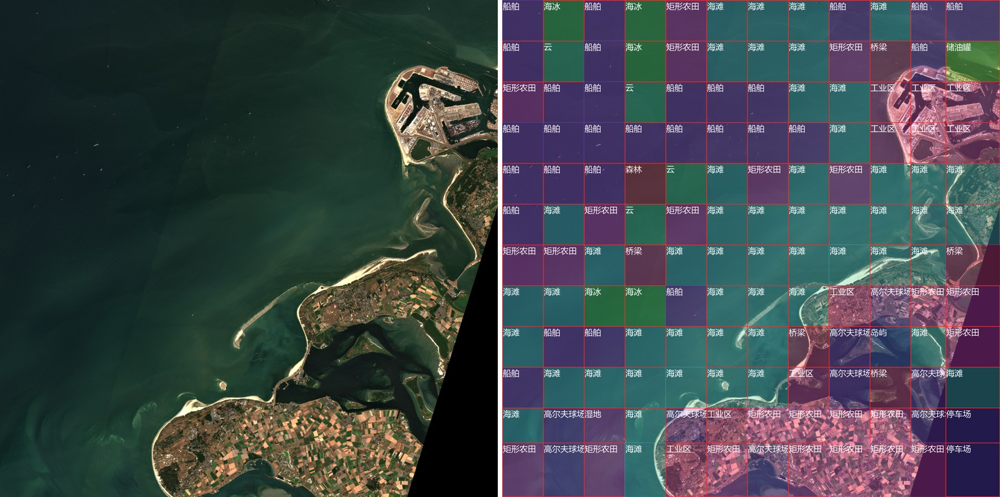

# GeoLens Studio：遥感影像地物分析服务

零标注数据流水线（CLIP 自动打标 → 置信度软加权 → LoRA 微调）+ 产品化分析服务（滑窗大图推理、GeoJSON/报告导出、FastAPI + Gradio + Docker 部署）。

**状态**：✅ v1 研究实验与 v2 产品化均已完成（22 项测试全绿）。计划见 [PLAN.md](./PLAN.md)，技术决策见 [DECISIONS.md](./DECISIONS.md)，v2 设计 [docs/specs](./docs/specs/)。

## 它是什么

两层结构，研究结论直接变成产品策略：

- **研究层（v1）**：回答"自动标注数据该怎么用"——五档严格消融证明**置信度应软加权而非硬过滤**（硬过滤 52.2% vs 软加权 62.0%，见下）
- **产品层（v2 Studio）**：把微调模型变成可部署的分析服务——上传任意大幅遥感影像（JPG/PNG/GeoTIFF），滑窗识别地物，输出叠加图 / 地物统计 / 带真实地理坐标的 GeoJSON / Markdown 报告；**VLM + CLIP 双模型交叉置信**，低置信窗口红框标出（建议人工复核，可回流为训练数据 = 数据闭环）

```
Gradio 工具界面 ──HTTP──► FastAPI 服务层 ──► 推理引擎
(ui/app_studio.py)      (service/api.py)   ├─ Tiler      滑窗切片（448²，重叠 25%）
    POST /analyze → task_id → GET /result   ├─ Classifier VLM 问答 + CLIP 交叉置信
                                           ├─ Aggregator 全图统计（占比/众数/低置信）
                                           └─ Exporter   叠加图 / GeoJSON(UTM) / 报告
```

## 真实卫星数据验证

[scripts/40_fetch_sentinel2.py](./scripts/40_fetch_sentinel2.py) 从 Earth Search STAC（免注册）拉取 Sentinel-2 真彩色 COG 窗口。实测：2026-08-12 鹿特丹港场景（云量 0.4%、41km 窗口），144 个窗口全流程分析：



判读合理（ship 29 窗、工业区、圩田农田——欧洲第一大港名不虚传）；同时 CLIP 交叉置信在真实 S2 数据上标记 88% 低置信窗口，诚实暴露学术训练集与真实影像的域差距——这正是"建议人工复核"机制的价值（[报告样例](./docs/assets/rotterdam_report.md)）。

## 性能基准（bench/benchmark.py，双端同口径）

| 环境 | 量化 | 单窗 P50 | 单窗 P99 | 吞吐 | 峰值显存 |
|---|---|---|---|---|---|
| RTX 5090 32G（服务器） | bf16 | **69 ms** | 82 ms | 14.4 窗/s | 7.05 GB |
| RTX 3060 Laptop 6G（本地） | **NF4 int4** | 857 ms | 915 ms | 1.15 窗/s | **2.61 GB** |

int4 量化让 3.7B 模型跑进 6GB 笔记本显卡（bitsandbytes NF4，全 GPU 无 offload），144 窗全图分析约 2 分钟。

## 快速开始

```bash
pip install -r requirements.txt        # 自备模型：Qwen2.5-VL-3B + LoRA adapter

# 1) 分析服务（本地 6G 显存走 int4）
GEOLENS_MODEL=models/qwen2.5-vl-3b GEOLENS_ADAPTER=models/adapter_weighted GEOLENS_4BIT=1 \
  uvicorn service.api:app --port 8000

# 2) 网页界面（另开终端）
python ui/app_studio.py --api http://127.0.0.1:8000

# 或 Docker 一键部署
docker compose up -d
```

REST 集成：`POST /analyze`（multipart 图像）→ 轮询 `GET /result/{id}` → `GET /result/{id}/download/{file}`，可被 QGIS / 任意脚本调用。测试：`pytest`（引擎与服务层 22 项）。

## v1 研究实验：自动标注数据的正确用法

通用 VLM 对遥感俯拍影像域差距严重（zero-shot 仅 24.7%）。零人工标注流水线：**CLIP 零样本打标（58.4%）→ 置信度过滤（τ=0.9 时标签精度 97.4%）→ 45 类中文知识库生成 6 万条指令**，LoRA 微调 Qwen2.5-VL-3B（LLaMA-Factory）。

| 模型 | 准确率 | 训练数据 |
|---|---|---|
| Qwen2.5-VL-3B zero-shot | 24.7% | — |
| + LoRA（clean 硬过滤） | 52.2% | 3019 张高置信图（标签精度 97.4%） |
| + LoRA（raw-matched 等量对照） | 56.2% | 3019 张随机抽样 |
| + LoRA（raw-full 全量） | 60.4% | 25200 张全量伪标签 |
| **+ LoRA（weighted 软加权）** | **62.0%** | 全量 + 高置信样本 2 倍权重 |

（RESISC45 test，45 类 × 10 张 = 450 张中文问答评测，五组见 [eval/](./eval/)）

**消融结论**：① 硬过滤**劣于**等量未过滤对照（52.2% vs 56.2%）——clean 模型 6 个类准确率为 0（CLIP 盲区长尾类被整类剔除），覆盖损失大于纯度收益；② 软加权**全场最优**（较硬过滤 +9.8 点）——**置信度应加权而非丢弃**，与弱监督学习软标签/熵加权思想一致。这一结论直接决定了 v2 产品的置信度用法：不丢弃窗口，用 CLIP 交叉验证打分标记复核。

## 复现

```bash
# 数据流水线（本地 3060 6G 即可）
python scripts/05_extract_parquet.py --parquet-dir data/resisc45/data --out-dir data/images --manifest data/manifest.csv
python scripts/10_clip_label.py --image-dir data/images --output data/labels.jsonl
python scripts/15_filter_analysis.py --labels data/labels.jsonl --decisions-out data/filter_decisions.jsonl --report-out data/filter_report.json
python scripts/20_build_instructions.py --labels data/labels.jsonl --decisions data/filter_decisions.jsonl \
    --out-clean data/instructions_clean.json --out-raw data/instructions_raw.json --out-raw-matched data/instructions_raw_matched.json

# 训练与评测（GPU 服务器，初始化见 training/setup_server.sh）
bash training/run_all.sh

# 单元测试
pytest
```

数据与模型致谢：[RESISC45](https://huggingface.co/datasets/timm/resisc45)（CC BY 4.0）；[Qwen2.5-VL-3B-Instruct](https://huggingface.co/Qwen/Qwen2.5-VL-3B-Instruct)（Apache 2.0）；Sentinel-2（[Earth Search](https://earth-search.aws.element84.com/) 公开 COG，[Copernicus](https://dataspace.copernicus.eu/) 计划）。代码 [MIT](./LICENSE)。
